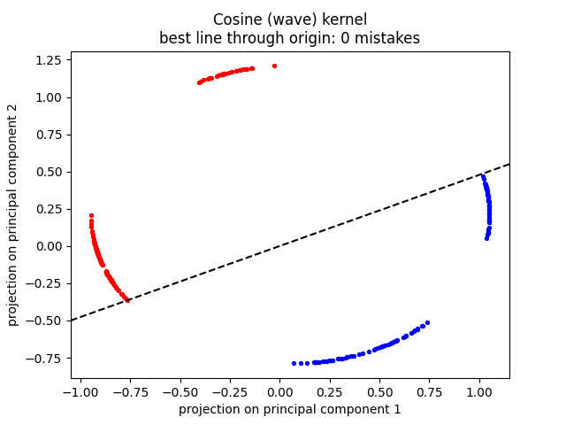
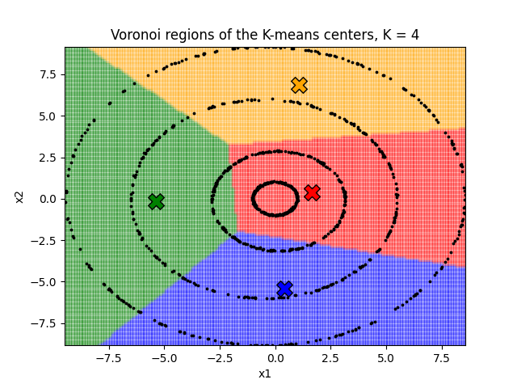
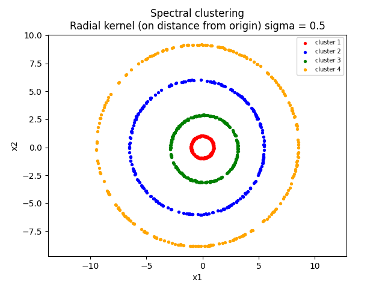

# kernel-eigenmaps

**PCA, kernel PCA, K-means, Voronoi regions, and spectral clustering — every
algorithm written from scratch with plain Python loops.**

The theme throughout: the eigenvectors of a well-chosen kernel matrix *are*
the map of the data. Pick the wrong kernel and the map shows nothing; design
the right one and separability or clusters simply fall out.

Two datasets, two puzzles, and the same lesson twice: when your data has a
shape, the right kernel is the one that *speaks that shape's language*.

- **Dataset 1** is eight tiny blobs whose labels zigzag like a wave → no
  standard kernel separates them, but a hand-built **cosine (wave) kernel**
  does it perfectly.
- **Dataset 2** is four concentric rings → K-means slices them like a pizza,
  but a **radial kernel** (it only looks at distance from the origin) makes
  spectral clustering recover all four rings exactly, 250 points each.

Course rules allowed *no* ML libraries — the only library calls are
`np.linalg.eigh` for eigenvalues/eigenvectors and matplotlib for plots.
Everything else (covariance, kernel matrices, centering, Lloyd's algorithm,
the spectral pipeline) is hand-rolled loops. All randomness is seeded, so
every figure in this repo regenerates exactly.

---

## Question 1 — the wave 🌊

*Dataset: 240 points in R², eight tight blobs, labels +1 (red) / −1 (blue).*

### (a) Plain PCA

Center the data, build the 2×2 covariance matrix, take its eigenvectors.

| | direction | eigenvalue | variance explained |
|---|---|---|---|
| PC1 | (−0.939, −0.343) | 1.258 | **61.95%** |
| PC2 | (0.343, −0.939) | 0.772 | **38.05%** |

Neither direction dominates — the blobs are spread all over, and red/blue
alternate, so no straight line can separate the classes.

### (b) Kernel PCA

Build the kernel matrix, center it in feature space, take the top two
eigenvectors; the projection of point *i* on component *j* is
√λⱼ · vⱼ[i]. Kernels tried, with the fewest classification mistakes any
line through the origin can achieve on the 2-D projection:

| kernel | best line's mistakes (of 240) |
|---|---|
| polynomial (1 + x·y)² | 90 |
| polynomial (1 + x·y)³ | 60 |
| polynomial (1 + x·y)⁵ | 43 |
| RBF σ = 0.1 | 30 |
| RBF σ = 0.16 | 30 |
| RBF σ = 0.5, 1, 2 | 60 |
| **cosine (wave) kernel** | **0** |

Polynomial kernels stretch the far blobs and squash the near ones; tiny-σ
RBF turns every blob into its own island (all top eigenvalues ≈ equal, so
two components can't hold eight islands). None of them untangle the labels.

### (c) The kernel that wins

Walking across the plane, the blob labels alternate — red, red, blue, blue,
red, red, blue, blue — like a square wave. So give the kernel a wave:

```
k(x, y) = cos( 3.3·(x₁ − y₁) − 0.6·(x₂ − y₂) )
```

This is a valid kernel: with t = 3.3x₁ − 0.6x₂ it equals
cos(tₓ)cos(t_y) + sin(tₓ)sin(t_y), the inner product of the feature map
x ↦ (cos t, sin t), which places every point on a circle. Red lands on one
half, blue on the other — **0 mistakes**, linearly separable.



## Question 2 — the rings 🎯

*Dataset: 1000 points in R², four concentric rings (radii ≈ 1, 3, 6, 9).*

### (a) K-means, k = 4, five random starts

Lloyd's algorithm from scratch. The error (sum of squared distances to own
mean) drops fast and never increases, but different starts land in
different local minima:

| start | 1 | 2 | 3 | 4 | 5 |
|---|---|---|---|---|---|
| iterations | 16 | 18 | 16 | 60 | 20 |
| final error | 12033 | 12211 | 12278 | 12299 | 12030 |

Every run cuts the picture into pie slices that mix pieces of several
rings — K-means reasons in straight-line distances, and rings don't.

### (b) Voronoi regions, K = 2, 3, 4, 5

Color every grid point by its nearest center and the failure becomes
geometric: the boundaries between K-means regions are always straight
lines, so ring-shaped clusters are impossible for *any* K.



### (c) Spectral clustering, k = 4

Top-4 eigenvectors of the kernel matrix → rows normalized to length 1 →
K-means on the rows. The ordinary RBF kernel fails (points on a big ring
are farther from each other than from the next ring over). The fix is a
kernel that only compares distances from the origin, r = ‖x‖:

```
k(x, y) = exp( −(r_x − r_y)² / (2·0.5²) )
```

Same ring → r nearly equal → kernel ≈ 1. Different rings → kernel ≈ 0.
Result: **exactly the four rings, 250 points each.**



### (d) The argmax shortcut

Assign point *i* to cluster ℓ = argmaxⱼ vⱼ[i] instead of running K-means
on the eigenvector rows. With the radial kernel this works perfectly
(250/250/250/250): the kernel matrix is nearly block-diagonal, so each top
eigenvector is almost an indicator of one ring. With the plain RBF kernel
it fails badly (one "cluster" grabs 592 points) — the eigenvectors smear
across rings. The shortcut only works when the kernel has already done all
the separating; normalize-and-K-means is the safer general recipe.

---

## Run it

Python 3.10+ (tested on 3.11 and 3.12).

```bash
pip install numpy matplotlib
python q1.py     # ~30 s  → writes q1*.png next to the script
python q2.py     # ~3 min → writes q2*.png next to the script
```

Committed copies of all 30 figures live in `figures/`; the scripts print
every number quoted above. `report/Report.pdf` is the full write-up.

## Layout

```
q1.py  q2.py            the two solutions (pure loops + eigh + matplotlib)
Dataset1.csv            240 labelled points (Q1)
Dataset2.csv            1000 points on four rings (Q2)
figures/q1  figures/q2  all generated plots
report/Report.pdf       submitted report
```

*Course assignment (Foundations of Machine Learning). AI assistance on code
and report was used and disclosed in the report, as permitted by the
instructor.*

MIT licensed.
